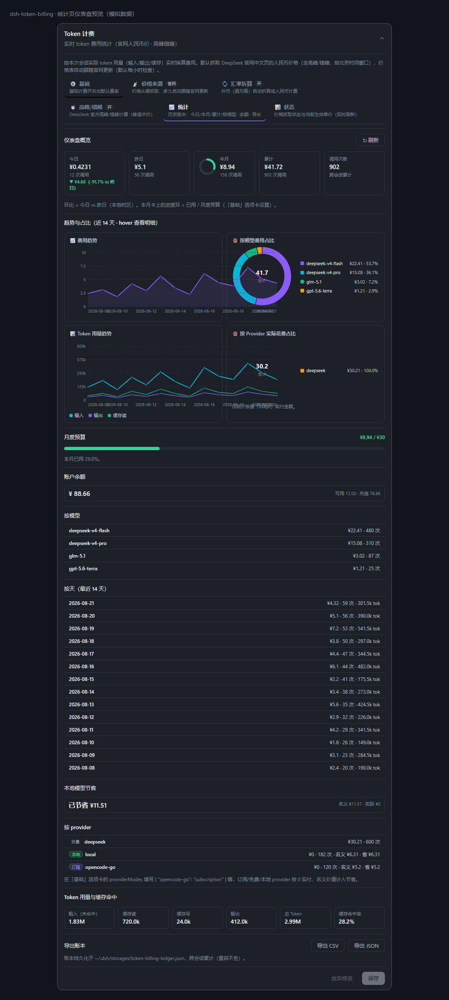

<div align="center">

# 💸 dsh-token-billing

**DeepSeek Harness (dsh) 实时 token 计费插件** · Real-time token billing for DSH

官网人民币价直接计费 · 按 (provider + 模型) 路由计价 · 高峰/错峰自动切换 · 价格实时跟随官网 · 可视化自定义模型价格 · 订阅/免费/本地收费形式分类 · 统计仪表盘（趋势折线图 + 占比环形图 + 预算预警）

[](LICENSE)
[](https://github.com/topics/dsh-plugin)
[](package.json)

</div>

---

## ✨ 这是什么

为 DeepSeek Harness（dsh）Web 提供**实时费用统计**：按本次会话实际的 token 用量（输入 / 输出 / 缓存读 / 缓存写四个桶）乘以模型单价，换算成费用，在输入框上方实时显示。

- **估算 → 精确自动修正**：流式生成期间用字符/4 启发式**估算**（标注「估」），收到模型的精确 usage 后**自动修正**；被中断（abort）的估算步骤**不会落地计费**。
- **零构建依赖**：手写 ESM 宿主 + `__ModuleLoader__` 客户端 bundle，与 modlens 同款立场。

> 输入框上方一行实时显示（与 TPS 同款样式）：
>
> ```
> 💸 ¥0.0302 · 12.3k in / 1.2k out · 本轮(估) ¥0.0011 · deepseek-v4-flash ¥4/M · 空闲
> ```

---

## 📸 界面一览

**统计页仪表盘（v0.7 · 纯手写 SVG 图表 · 模拟数据渲染）**：



图中可见：KPI 概览卡（今日 / 昨日环比 / 本月·预算环 / 累计 / 调用次数）· 费用趋势折线图 · 按模型费用占比环形图 · Token 用量趋势折线图 · 按 Provider 实际花费占比环形图 · 月度预算进度条 · 账户余额 · 按模型 / 按天明细。

> 截图由 `scripts/render-preview.mjs` 用模拟账本数据生成；真实界面随实际账本数据展示。

---

## 🛠 更新日志

### v0.8.1（2026-09-12）

**修复：费用行「当前单价」段在走全局价目表时会显示官方档位名，容易被误读为「插件认错了模型」。**

- 该段此前渲染**命中那条价目行的名字**。走全局表（官方定价页）时那个名字是**官方档位名**
  （如 `deepseek-flash`），于是中转路由下的 `deepseek-v4.1-flash` 会被显示成 `deepseek-flash`。
- 现改为优先显示**你实际选中的模型名**，仅当它与计价档位名不同时附注：
  `deepseek-v4.1-flash ¥4/M（按 deepseek-flash 计价）`。
- **价格本身一直是正确的** —— 档位归一化只影响「匹配哪条价目」，不影响金额。实测：重启后
  27 条 `deepseek-v4.1-flash @mxy` 记录与官方空闲价重算**逐位吻合（1.0000×）**。本版**仅修显示**。
- 决策逻辑抽为具名函数 `priceLineParts`，由 `tests/client-alias-parity.mjs` **从源码提取**后断言
  （5 条行为 + 2 条接线/回归），该测试 **10 → 17 通过**。

### v0.8.0（2026-09-11）

**三件事：计价正确性修复（官方页脚注污染 / 模型改名档位 / 2026-08-17 峰谷起点与 2026-09-10 12:00 flash 调价）、让「按路由计价」真正生效、补齐兼容声明与自包含测试。**

#### 一 · 计价正确性修复

- **官方页脚注污染（价格 key 失配）** —— 官网定价页模型表头带脚注标记，旧解析器产出脏 key `deepseek-flash(1)` / `deepseek-v4-pro(2)`，与真实模型名永不相等：官方抓到的价等于没用，一直回落到内置旧价（缓存读约 25 倍多算、输入约 2 倍多算）。新增 `stripFootnoteMarks` / `canonicalModelId` / `modelTier`（`lib/prices.js`，解析层与写入层**共用的单一归一化函数**），`parseDeepSeekPricingHtml` 的模型键、`fetchedToFlat`、`flattenPiAiCost`、`fetchJsonPrices` 与 `applyFetchedPrices`（全局表与 provider 桶）全部在**写入前**归一化，脏 key 不再落进价格缓存。实测现页（2026-09-11 抓取）解析结果为 `deepseek-flash` / `deepseek-v4-pro`，无任何括号脚注。
- **模型改名与档位归一化** —— 官方现名为 `deepseek-flash`；旧名 `deepseek-v4-flash` / `deepseek-v4.1-flash` / `deepseek-v4-flash-0731` / `deepseek-v4-flash-ga-260731` / `deepseek-v4-flash-vision-exp` / `DeepSeek-V4-Flash-0731` / `deepseek/deepseek-v4-flash-0731` 等仍可调用并按 Flash 价计费，故统一归入档位。大小写、分隔符与 vendor 前缀不敏感，10 个真实模型名全部命中正确档位；非 DeepSeek 键形不变（`mimo-v2.5` / `deepseek-chat`）。
- **官方现价 + 价格政策时间线** —— 内置表更新为官方现值：flash 空闲 `1/4/0.02/1`、高峰 `2/8/0.04/2`；pro 空闲 `4.5/13.5/0.15/4.5`、高峰 `9/27/0.3/9`。新增 `PRICE_POLICY_TIMELINE`（`lib/projection.js`）三段：**平价段**、**2026-08-17 00:00（北京）峰谷起点**（flash 高峰 `3/9/0.1/3`）、**2026-09-10 12:00（北京）flash 新价**。取价按**消息发生时刻**选段：非最新段一律用内置历史价（**历史回看不被新规追溯改写**），最新段在已有人民币抓取价时让位抓取表（从而可跟随官网未来调价）。
- **周末空闲规则曾被「默认值不等价」挡在门外** —— 官方 2026-08-23 起高峰仅周一至周五（周末全天空闲价）；但 `windowsAreDefault` 原本只认「内置北京时间带 days」一种写法，用户端 Config 里那份**旧版 UTC 默认窗口**（`[["01:00","04:00"],["06:00","10:00"]]`）被误判为「用户自定义」，于是官网抓到的窗口（含工作日）进不来、周末规则失效。本版改为**语义等价即视为默认**（同时认「旧 Config 默认 UTC 无 days」「北京时段但漏写 days」「内置北京带 days」三种写法），并同步 `tzIsDefault`（`Asia/Shanghai` / `UTC` / 空值都算默认）；真正自定义的窗口（如 `22:00-23:00`）不被覆盖。
- `DEFAULT_FALLBACK`（仅在配置缺省时兜底；正常安装下 Config 默认 `2/8/0.5/2` 先行生效）同步更新为官方 Flash 空闲价 `1/4/0.02/1`。

#### 二 · 按路由计价（per provider + model）

- **此前形同虚设** —— provider 级取数指向本机**根本没安装**的 `@earendil-works/pi-ai` 目录，取数函数永远返回空表，provider 价目恒空、「按路由计价」从未生效。本版改为**三层取数：磁盘 → asar 归档 → 随包内置**（`lib/prices.js` `loadProviderPrices`），来源如实标注为 `disk` / `asar` / `builtin`，取不到即 `none` —— 空表不建桶、不登记来源（不谎报）。
- **内置 coding-plan 价表（随包分发）** —— 新增 `lib/coding-plans.js`（**生成物，勿手改**），由本机 DSH 打包的 pi-ai catalog（v0.85.1，catalog generatedAt `2026-09-05`）生成，覆盖 **9 个 provider**：`opencode-go` / `opencode` / `kimi-coding` / `qwen-token-plan`(+`-cn`) / `xiaomi-token-plan-ams|-cn|-sgp` / `zai-coding-cn`。`node scripts/sync-coding-plans.mjs` 可在 DSH 升级后重新生成（asar 路径不硬编码、多候选探测；三层全不可得才清晰报错并以非 0 退出）。
- **订阅 / 免费 / 本地** —— 价表**如实保留 catalog 挂牌价、不在价表里抹 0**：订阅用户的「实际花费归零」由 `providerModes` 的 `subscription` 模式在**结算层**完成；抹 0 会让名义价值 / 回本无法计算（`zai-coding-cn` 即按此处理）。此处与上游把订阅计划一律抹 0 的做法**有意不同**。
- **未命中不跨 provider 串价** —— 旧 `priceAt` 在 provider 未命中时会继续扫描**其它** provider 的同名模型价（同一真实模型经不同聚合网关中转，单价并不相同），本版改为未命中即回落全局表 / 官方政策链。实测：`opencode-go` 下 `deepseek-v4-flash-0731` 取该 provider 自己的价目；换成无价目的 `hy` 时取政策链价（2026-09-11 高峰 `2/8/0.04/2`），**不会**借 `opencode-go` 的价。
- **官方 DeepSeek 恒由官方价格政策时间线定价** —— 内置 provider 价表**不收录** first-party `deepseek`：catalog 里的 `deepseek.json` 是 **pre-2026-08-17 的静态快照**（USD、输出折算约 ¥2.016、`cacheWrite` 记 0、时间无关、完全不参与峰谷），一旦被种进 `providerPrices['deepseek']`，就会按「provider 表优先」盖住政策链并绕开历史回看保护。实测：修复前 08-20 峰/闲、09-11 峰/闲**四个时点同值** `2.016/0.02016/0`；修复后同四时点为 `3/9/0.1/3`、`1.5/4.5/0.05/1.5`、`2/8/0.04/2`、`1/4/0.02/1`（输出由 ¥2.016 恢复为空闲 ¥4 / 高峰 ¥8，`cacheWrite` 由 0 恢复为 ¥1/¥2，峰谷与历史回看保护同时恢复）。跳过只以 **provider id** 为键（`POLICY_PRICED_PROVIDER_IDS = ['deepseek']`，由生成脚本模板产出、重跑 sync 不会丢），不误伤其它 provider（如 `opencode-go` 的 catalog 价原样保留）；**用户显式配置的 provider 价仍然优先**（逃生口保留）——实测用户为 `deepseek` 显式钉价后，四个时点同取该显式价。
- **按路由价目可视化编辑** —— 设置卡新增「🧭 按路由」页：增删 `provider + 模型` 行，逐项填输入 / 输出 / 缓存读 / 缓存写与币种，并就地设置各 provider 收费形式；可列出**本机实际配置的路由**（读 `llm-pi-ai.providers`）与账本里真实出现过的 provider，点选模型即加行。新增只读 `GET /token-billing/providers`（本机路由 + 各 provider 当前价目 / 来源 / 收费形式 / 价格 URL）。

#### 三 · 兼容声明与自包含测试

- **`package.json` 补齐兼容声明**（0.7.2 → 0.8.0）：`engines`（`node ^22.19.0 || >=24.0.0`、`dsh >=0.1.0-rc.8 <0.2.0`）、`peerDependencies`（`@deepseek-ai/cordis ^4.0.1`、`@deepseek-ai/dsh-settings >=0.1.0-rc.8 <0.2.0`、`@deepseek-ai/schemastery ^3.18.1`、`react ^18.2.0`、`zod >=4.0.0 <5.0.0`）、`dsh.compatibility`（`dsh` 范围 + `dshReleases` 逐版本 `compatible` 映射，覆盖 `0.1.0-rc.8` → `0.1.5-rc.2` 共 15 项）。下界取 **`0.1.0-rc.8`**：本机在跑的核心就是 0.1.0-rc.8、DSH 桌面端内置核心为 0.1.5-rc.1；用插件市场自己的判定模块实测，生态常见的 `>=0.1.1-rc.1` / `>=0.1.2-rc.1` 写法会把 rc.8 判为 incompatible（造成回归），而 `>=0.1.0-rc.8` 对 rc.8 → 0.1.5-rc.2 全部 compatible；`exports` / `files` / `dsh.bundle` / `dsh.client` 原样保留。
- **`tests/schema-check.mjs` 改为自包含** —— 去掉硬编码绝对路径与对 zod 的 `require`（旧版在别的机器上直接 `MODULE_NOT_FOUND`，测试实际是坏的），改为内置极简校验器并保留原断言强度（类型 / 必填 / 非负 / strict 不允许多余键 / nullable / optional / record / tuple.rest），含 **16 项校验器语义自检** + **6 个视图场景**（内置表 / 官网高峰价 / 官网错峰价 × 进行中 / 结算后）。
- **新增 schema 同构门禁** `scripts/check-schema-parity.mjs`（`npm run check:parity`）—— 一条命令逐字对比「测试镜像 schema ≡ 运行时 wire schema」，防止「测试比 runtime 宽松 → 假绿」（本轮真实事故：镜像给 `windows` 多写了 `.rest()`，测试全绿而宿主会拒发整个视图）。
- **费用行别名匹配修复** —— 价表键是规范名（`deepseek-flash`）而界面标签是历史别名时，费用行取不到单价（费用行 blocker）。修法：价目行保留客户端可匹配的原始标识，且 `findPrice` 对**双方**做档位归一化（`lib/client.js`）；新增 `tests/client-alias-parity.mjs` 钉住「客户端档位镜像 ≡ 服务端归一化」的单一真源。
- **测试规模**：`tests/simulate.mjs` 123 → **206** 项；新增 `tests/route-pricing-test.mjs`（**62** 项）、`tests/client-alias-parity.mjs`（**10** 项）。

### v0.7.2（2026-08-25）

**修复：高峰窗口缺「星期几」维度——2026-08-23 起官方高峰仅限周一至周五，周末全天空闲价。**

官方于 2026-08-23（北京时间）起调整峰谷规则：高峰时段只落在**周一至周五**，周六周日全天按空闲价（半价）。
旧版窗口数据结构只有 `[起分, 止分]`（一天里的分钟），抓下来的「周一至周五」没处放，周末请求仍按高峰价计费（每周约 14 小时多计一倍）。本版为窗口增加星期几维度：

- **窗口支持第三维 days**：`[起分, 止分, [1,2,3,4,5]]`（0=周日…6=周六，缺省 = 每天）；新增 `weekdayInTz(atMs, tz)` 按**同一 tz** 读星期几（不退回 `getUTCDay()`，规避 UTC/北京两本日历在周五/周日 16:00-24:00 UTC 的分歧）
- **官网解析**：中文页识别「周一至周五 / 工作日」，英文页识别 "Monday through Friday" / "weekdays"，自动写入 days；英文页窗口 +8h 折算为北京时间，与中文页同一日历
- **历史回看不减半**：周末空闲规则加 effectiveAt 门控（生效时刻 `2026-08-22T16:00:00Z`），生效前的周末仍按高峰价计费——回看旧账不会少算一半
- **默认窗口/时区**改为北京时间（Asia/Shanghai）+ 工作日限定
- 用 [deepseek-peak-hours](https://github.com/xyzs996/deepseek-peak-hours) 的 15 条边界向量验证：**15/15 通过**（修复前 10/15）；本地测试套件 123 通过 / 0 失败

### v0.7.1（2026-08-24）

**修复：DSH 桌面端 2.0.2（核心 0.1.1-rc.1+）下费用行不显示、账本冻结。**

核心 0.1.1-rc.1 起，`sessionProjections.register()` 改为只读 `wire: { viewSchema, view }` 块，
旧顶层 `schema` / `view` 字段被忽略，投影被当成「仅宿主内部」：宿主照常计费，但浏览器端
永远收不到数据（费用行隐藏、账本自升级起不再写入）。本版按官方 dsh-context 插件的兼容写法
同时提供新旧两套注册字段，**rc.8 与 rc.1+ 双核心通用，无需改动安装方式**——升级桌面端后
请更新本插件到此版本并重启 DSH。

另含：`blocks` 初始化从数组改为对象（修复宿主 plain-JSON 序列化契约告警）、
`usage` 字段缺失回退 0、费用行投影缺失时静默隐藏。

### v0.7.0

统计页升级为仪表盘（KPI 概览 + 趋势折线图 + 占比环形图 + 月度预算预警）。

### v0.6.0

Provider 收费形式（订阅 / 免费 / 本地）+ Token 缓存命中统计。

---

## 🚀 安装

### 方式一：DSH 插件市场（推荐，待上架）

1. 打开 DSH → **设置 → 插件 → 市场**
2. 搜索 `dsh-token-billing`，点 **安装**
3. 重启 DSH Web

### 方式二：GitHub 直接安装

```bash
# 在 web profile 目录下执行
cd ~/.dsh/profiles/web
pnpm add github:2006spy/dsh-token-billing#main
```

然后在 `~/.dsh/profiles/web/cordis.patch.yml` 追加：

```yaml
- insert:
    - id: token-billing
      name: dsh-token-billing
```

重启 dsh web 即可。

### 方式三：本地源码链接（开发）

```bash
git clone https://github.com/2006spy/dsh-token-billing.git
# ~/.dsh/profiles/web/package.json → dependencies:
#   "dsh-token-billing": "link:<绝对路径>"
# ~/.dsh/profiles/web/cordis.patch.yml → 挂载行同上
```

### 兼容范围（v0.8 起显式声明）

- **核心（`dsh`）**：`>=0.1.0-rc.8 <0.2.0` —— 本机 CLI 核心 0.1.0-rc.8 与 DSH 桌面端内置核心 0.1.5-rc.1 均实测兼容；`dsh.compatibility.dshReleases` 逐版本标注兼容性（`0.1.0-rc.8` → `0.1.5-rc.2` 共 15 项）
- **Node**：`^22.19.0 || >=24.0.0`
- **peer 依赖**：`@deepseek-ai/cordis` · `@deepseek-ai/dsh-settings` · `@deepseek-ai/schemastery` · `react` · `zod`（范围见 `package.json`）

---

## 🎯 核心特性

### 官网人民币价格直接计费
默认抓取 [DeepSeek 官网中文页](https://api-docs.deepseek.com/zh-cn/quick_start/pricing)（`¥` 标价，现价 flash 空闲 `0.02/1/4` 元、高峰 `0.04/2/8` 元），**无需汇率换算**；英文页（USD）兜底，可用「外币自动折算人民币」按汇率折算。

### 价格实时跟随官网
默认 **1 小时**自动检查并重抓官网价格表（后台周期定时器 + 缓存过期重抓 + 卡片手动刷新）；**高峰/错峰生效时刻到达后 1 分钟内自动切换**，无需重启。

### 按路由计价（per provider + model，v0.8）
按 **(provider, model) 双键**取价：同一个模型名在不同中转 provider 下各取各自价目（如 `deepseek-v4-flash-0731` 在 `opencode-go` 与 `mxy` 下是两条价）。取价优先级：

**用户覆盖（钉死）> 该 provider 的价目 > 内置价格政策时间线 > 全局表（官网抓取 / 内置）> fallback**

- **provider 价目是固定价、不参与高峰/错峰**（同用户覆盖）。若希望某 provider 的 DeepSeek 模型跟随官方峰谷政策，请**留空该 provider 的价目**，让它回落到内置价格政策时间线。
- **未命中不跨 provider 串价**：该 provider 没有这个模型时，回落全局表 / 官方政策链，**不会**去借别的 provider 的同名模型价。
- **内置 coding-plan 价表**：随包分发 9 个 provider 的官方美元价（`lib/coding-plans.js`，由本机 DSH 内置 pi-ai catalog 生成；`node scripts/sync-coding-plans.mjs` 可在 DSH 升级后重新同步），与磁盘 / asar 两层的 catalog 价共同构成三层取数（来源如实标注，空表不登记）。
- **订阅 / 免费 / 本地**：`providerModes` 按 provider（支持 glob）分类；价表**如实保留挂牌价**，「订阅实付归零」交给结算层完成（详见下方「Provider 收费形式」）。
- **官方 DeepSeek 恒由官方价格政策时间线定价**：内置表**不提供** `deepseek` 固定价（catalog 那份是 pre-2026-08-17 的静态快照，会按「provider 表优先」盖住政策链），官方模型一律走时间线；**用户显式配置的 provider 价仍优先**（逃生口保留）。
- 设置卡「🧭 按路由」页可视化编辑（增删 `provider + 模型` 行、逐项定价、就地设收费形式、可从本机路由一键点选）；`GET /token-billing/providers` 输出本机路由与各 provider 的当前价目 / 来源（`override` / `custom-json` / `disk` / `asar` / `builtin` / `none`）/ 收费形式。

### DeepSeek 高峰/错峰计费（官方口径）
- 高峰：**北京时间周一至周五 09:00-12:00 与 14:00-18:00**，其余（含整个周末）为空闲时段（半价）
- 周末空闲价自**北京时间 2026-08-23 00:00** 生效（生效前周末仍按高峰价，历史回看不减半）
- 插件自动解析官网的窗口（含「周一至周五」天限定）与时区，按请求发生时刻 + 星期几自动切换计价
- 内置价随**价格政策时间线**按消息时刻取段：**2026-08-17** 峰谷起点、**2026-09-10 12:00** flash 调价，历史回看不被新规追溯改写（详见「计费口径」）
- 费用行实时显示当前「高峰 / 空闲」徽标

### 可视化自定义模型价格
设置卡「基础」里用表格可视化添加/删除自定义模型与价格（模型 ID + 输入/输出/缓存读/缓存写/币种），替代手写 JSON，实时生效。

### 多币种兜底
非人民币的外币价按汇率折算为目标货币；不同币种分别累计显示。

### 持久化历史账本 + 多维统计（v0.5）
每条结算 step 幂等落盘 `~/.dsh/storages/token-billing-ledger.json`，**跨会话累计、重启不丢**。
「统计」卡展示 **今日 / 本月 / 累计 / 按模型 / 按天**（本地时区）。

### 账户余额查询（v0.5）
调官方 `GET /user/balance`（复用 `DEEPSEEK_API_KEY`），统计卡实时显示余额（60s 缓存，失败静默降级，key 不下发浏览器）。

### CSV / JSON 导出（v0.5）
统计卡一键导出账本：CSV（带 BOM，Excel 友好）或 JSON。

### 本地模型节省统计（v0.5）
配置 `localProviders`（如 `local*`）与 `localCostPerM`（实际成本，默认 0 = 免费）后，
本地（自托管）模型调用按官方价计**名义价值** - 实际成本 = **已节省**，统计卡实时显示。

### Provider 收费形式（v0.6，参考 dsh-web-billing）
配置 `providerModes`（JSON，如 `{"opencode-go":"subscription","local*":"local","*free*":"free"}`）后，
订阅制 / 免费 / 本地 provider 的调用**实际花费按 0 计**，官方名义价折算为「节省/回本」：

| 模式 | 说明 |
| --- | --- |
| `usage` | 按量：按官方/配置价实算花费（默认） |
| `subscription` | 订阅（如 opencode-go $10/月）：实际花费 0，名义价值计「回本」 |
| `free` | 活动免费：实际花费 0（真正白嫖） |
| `local` | 本地部署：实际花费 0（或按 `localCostPerM`），省的是 API 钱 |

- 支持 glob 匹配（`local*` / `*free*`）；精确匹配优先于 glob
- 统计卡「按 provider」按此分类显示实际花费 / 名义价值 / 节省（徽标着色：按量灰 / 订阅紫 / 免费天蓝 / 本地绿）
- **历史重估**：配置后，账本中未带 mode 的旧记录按当前配置重新分类统计，无需改账本
- 每条结算 step 会把当时的收费形式（mode）持久化进账本，导出 CSV/JSON 可见

### Token 用量与缓存命中统计（v0.6）
统计卡新增「Token 用量与缓存命中」：未缓存输入 / 缓存读 / 缓存写 / 输出 / 总 Token / 缓存命中率。

### 统计仪表盘（v0.7，参考中转站 one-api / new-api 首页 + dsh-web-billing 费用页）
统计页升级为**仪表盘**，纯手写 SVG 图表（零构建依赖，深浅主题自适应，hover 查看明细）：

- **KPI 概览卡**：今日 / 昨日 / 本月 / 累计 / 调用次数；今日卡带 **vs 昨日环比**（▲ 红 = 花多了，▼ 绿 = 省了）；本月卡带**预算进度环**
- **📈 费用趋势折线图**：近 14 天每日费用（面积渐变 + hover 竖线与明细 tooltip）
- **📊 Token 用量趋势折线图**：近 14 天输入 / 输出 / 缓存读三条线 + 图例
- **🍩 按模型费用占比环形图**：扇形占比 + 中心合计 + 图例（超 8 项自动合并「其他」）
- **🍩 按 Provider 实际花费占比环形图**：按量实付分布；全为订阅/免费/本地时给出提示
- **月度预算预警**：`monthlyBudget` 配置后显示进度条（绿 → 琥珀 → 红，超支红色高亮并显示超支金额）
- 仪表盘顶部「↻ 刷新」一键重拉统计与余额；按天明细表新增每日 token 总量

---

## ⚙️ 配置

「设置 → 插件 → Web UI 插件 → **Token 计费**」卡片，保存即时生效（重建投影）。

### 基础

| 字段 | 默认 | 含义 |
| --- | --- | --- |
| 启用实时计费 | 开 | 总开关 |
| 默认货币符号 | `¥` | 目标计费货币；官网人民币价直接使用，其他外币价按汇率折算 |
| 未知模型 · 输入/输出/缓存读/缓存写价 | 2 / 8 / 0.5 / 2 | 未覆盖模型的默认价（每 1M token） |
| 模型价格覆盖 | `{}` | **可视化编辑器**：逐格填「模型 ID + 输入/输出/缓存读/缓存写/币种」，可增删行；也可直接写 JSON `{ "deepseek-chat": {"input":2,"output":8} }`；优先级最高，不参与高峰/错峰 |
| 本地模型提供方（glob） | — | 本地/自托管 provider 名单（如 `local*`），按官方价计名义价值；逗号分隔 |
| 本地模型实际单价 | `0` | 本地模型每 1M token 实际成本（默认 0 = 免费，可填电费/算力成本）；名义价值 − 实际成本 = 已节省 |
| 月度预算（默认货币） | `0` | 0 = 不设预算；设置后统计页显示预算进度环与进度条预警（绿 → 琥珀 → 红，超支红色高亮） |
| Provider 收费形式（JSON） | `{}` | 如 `{"opencode-go":"subscription","local*":"local","*free*":"free"}`；订阅/免费/本地按 0 实付、名义价计节省（见上） |

### 按路由（per provider + model 价目）

| 字段 | 默认 | 含义 |
| --- | --- | --- |
| 按路由价目（`providerPrices`，provider + 模型） | `{}` | 设置卡「🧭 按路由」编辑器的持久化形态：`{"mxy":{"deepseek-v4-flash-0731":{"input":1,"output":4,"cacheRead":0.02,"cacheWrite":1,"currency":"¥"}}}`；可只填部分字段（缺省字段按全局生效价回填，避免 NaN）。**固定价、不参与高峰/错峰**，优先级仅次于「模型价格覆盖」 |

- 取价优先级：**模型价格覆盖（钉死）> 按路由价目 > 内置价格政策时间线 > 全局表（官网抓取 / 内置）> fallback**
- 编辑器可增删 `provider + 模型` 行、逐项填四项价与币种、就地设置各 provider 收费形式；并可列出本机实际配置的路由（读 `llm-pi-ai.providers`）与账本里真实出现过的 provider，点选模型即加行
- 想跟随官方峰谷政策的 provider **不要**在此钉价（固定价不参与峰谷），留空让它回落到政策时间线

### 价格来源

| 字段 | 默认 | 含义 |
| --- | --- | --- |
| 价格来源 | DeepSeek 官网 | `deepseek`（**中文页·人民币**，自动抓取，英文页兜底）/ `custom-json`（自定义端点）/ `builtin`（仅内置表） |
| 自定义价格 URL | — | 返回 `{ "模型id": {"input":..,"output":..,"cacheRead":..,"cacheWrite":..} }` 或 `{ "currency":"CNY", "models":{...} }` |
| 各提供商价格 URL（`providerPriceUrls`，JSON） | `{}` | `provider → URL` 映射，如 `{"mxy":"https://…"}`；抓取结果写入**该 provider 的价目**（来源标 `custom-json`），与三层 catalog 价并存、优先级高于 catalog 价 |
| 自动刷新间隔 | 1h | 后台周期检查，价格表跟随官网实时更新 |

### 汇率折算

| 字段 | 默认 | 含义 |
| --- | --- | --- |
| 外币自动折算人民币 | 开 | 抓取到外币价（如 $）时按汇率折算为目标货币 |
| 汇率（1 外币 = N 元） | `7.2` | 仅对外币价生效（官网人民币价直接使用） |

### 高峰/错峰（DeepSeek 官方计费）

| 字段 | 默认 | 含义 |
| --- | --- | --- |
| 启用高峰/错峰 | 开 | 总开关（需抓取到官方高峰价表才生效） |
| 高峰窗口 | 旧版 UTC 默认（视为「跟随官网」） | schema 默认值为 `[["01:00","04:00"],["06:00","10:00"]]`（旧版 Config 的 UTC 窗口），与内置默认（**北京时间 09:00-12:00 与 14:00-18:00、仅周一至周五**）**语义等价**、都算「未自定义」，因此官网抓到的窗口会自动替换它；窗口**第 3 位可带星期几**（如 `[["09:00","12:00",[1,2,3,4,5]]]`，0=周日…6=周六，缺省每天）；真正自定义的窗口不被官网覆盖 |
| 错峰折扣率 | `0.5` | 官方空闲 = 高峰 × 0.5 |
| 适用模型 | `deepseek-*` | glob，逗号分隔 |
| 窗口时区 | `UTC`（视为「跟随官网」） | schema 默认 `UTC`（旧版默认），与内置 `Asia/Shanghai` 同属「默认等价」写法，官网抓到时区会自动跟随；自定义时区不被覆盖 |
| 忽略生效日期 | 关 | 官方周末空闲价自**北京时间 2026-08-23 00:00** 生效（高峰仅周一至周五）；勾选后立即启用 |

### 状态（实时查看）

- **价格抓取状态**：来源、最近更新时间、覆盖模型数、高峰/错峰窗口与生效时刻；「立即刷新价格」按钮手动抓取并重建投影。
- **当前生效单价表**：列出所有模型当前生效价（含高峰/错峰，按此刻计价），切换模型/时段变化后实时刷新。

### 统计（仪表盘 · 历史账本 · 余额 · 导出 · 节省 · 收费形式 · 缓存命中）

- **仪表盘概览**：KPI 卡（今日 / 昨日环比 / 本月·预算环 / 累计 / 调用次数）+ 近 14 天**费用趋势折线图** + **Token 用量趋势折线图** + **按模型 / 按 Provider 占比环形图**（hover 查看明细，详见上方 v0.7 一节）
- **月度预算**：`monthlyBudget` 配置后显示进度条预警（超支红色高亮）
- **费用汇总**：今日 / 本月 / 累计（多币种，本地时区）
- **账户余额**：官方余额实时显示（需 `DEEPSEEK_API_KEY`）
- **按模型 / 按天**：历史明细（按天最近 14 天，含每日 token 总量）
- **按 provider**：每个 provider 的实际花费 / 名义价值 / 节省与收费形式徽标（按量灰 / 订阅紫 / 免费天蓝 / 本地绿）
- **Token 用量与缓存命中**：未缓存输入 / 缓存读 / 缓存写 / 输出 / 总 Token / 缓存命中率
- **本地模型节省**：已节省 / 名义价值 / 实际成本
- **导出**：CSV / JSON 一键下载账本

---

## 📊 显示

输入框上方一行（与 TPS 同款样式）：

```
💸 ¥0.0302 · 12.3k in / 1.2k out · 本轮(估) ¥0.0011 · deepseek-v4-flash ¥4/M · 空闲
```

- 第一段：本会话累计费用（默认人民币；多币种时按币种分别显示）
- 中间：输入 / 输出 token 累计
- 第三段：当前一轮（turn）费用，进行中显示「(估)」，结算后自动变精确
- 当前模型段：`<模型id> <当前生效输出单价>/M`，随模型切换实时更新（含高峰/错峰）
- 尾部徽标：峰谷计费生效时显示当前是「高峰」还是「空闲」
- 悬停（title）：按模型的费用明细（含币种）、价格来源、当前高峰/空闲状态与**高峰窗口区间**（按 `起-止` 渲染，如 `09:00-12:00 / 14:00-18:00`）

> **星期几只参与宿主侧计费判定，不出现在投影视图与界面文本里**：投影视图的 `billing.windows` 只承载 `[起, 止]` 二元组（`lib/projection.js` 的 `createBillingView` 按 `[起, 止]` 输出，星期几维度仅在计价内部使用），悬停提示也只渲染 `起-止` 区间。因此「仅周一至周五」是**计费口径**（宿主 `priceAt` 的判定），不是界面文案。

---

## 🧮 计费口径

- 价格 = 每 1M token 单价；`费用 = 未缓存输入×in + 输出×out + 缓存读×read + 缓存写×write`（除以 1M）
- 精确 usage 到达前，输出按 `ceil(字符/4)+4` 估算，输入按系统提示 + 工具 schema + 会话表面估算
- `assistant/message` 或 `usage` chunk 携带精确用量时，该步立即换成精确值
- 结算时刻（step/end）决定该步落在高峰还是空闲：按请求时刻在窗口时区中的**分钟 + 星期几**判定（窗口可带 days 限定，缺省每天）；**用户覆盖与 provider 价目都是固定价，不参与高峰/错峰**
- **历史回看**：周末空闲规则带生效时刻门控（2026-08-22T16:00:00Z）——回看生效前的周末仍按高峰价，旧账不会因新规被减半
- **按路由取价优先级**：用户覆盖（钉死）> 该 provider 的价目 > 内置价格政策时间线 > 全局表（官网抓取 / 内置）> fallback；provider 未命中**不跨 provider 串价**，直接回落全局表 / 政策链
- **价格政策时间线**（按**消息发生时刻**取价）：平价段（2026-08-17 前）→ **2026-08-17 00:00（北京）峰谷起点** → **2026-09-10 12:00（北京）flash 新价**；官网「周末全天空闲」自 **2026-08-23** 起生效。非最新政策段一律用内置历史价（**历史回看不被新规追溯改写**），最新段在已有人民币抓取价时让位抓取表
- **模型别名 / 档位归一化**：`canonicalModelId` 把 DeepSeek flash 家族（`deepseek-flash` / `deepseek-v4-flash` / `deepseek-v4.1-flash` / `…-0731` / `…-ga-260731` / `…-vision-exp` / `DeepSeek-V4-Flash-0731` / `deepseek/deepseek-v4-flash-0731`）统一归到 `deepseek-flash`，pro 家族（`deepseek-v4-pro` / `deepseek-v4-pro-0813`）归到 `deepseek-v4-pro`；大小写与分隔符不敏感，其余模型键形不变。解析层与写入层**共用同一归一化函数**，官方页脚注类脏 key 不再落盘
- 非 `completed` 结束（abort/error）的估算步骤自动退款，不计入总计
- **收费形式**：`providerModes` 配置的订阅/免费/本地 provider，结算仍按名义价记入账本（含 mode 字段），统计层把实际花费归 0、名义价值计入节省/回本；未配置时全部按 `usage` 按量计
- **实时跟随官网**：价格表默认每小时自动重抓（可配置）；峰谷价在生效时刻到达后 1 分钟内自动切换，无需重启

---

## ✅ 验证

```sh
node tests/simulate.mjs             # 206 项：计价/估算/多币种/退款/中英文官网解析/峰谷时段/周末空闲/生效切换/历史回看/折算/序列化/脚注归一化/档位别名/政策时间线/不跨 provider 串价
node tests/schema-check.mjs         # 视图 wire schema 校验：校验器语义自检 16 项 + 6 个场景（内置表 / 官网高峰价 / 官网错峰价 × 进行中 / 结算后）
node tests/ledger-test.mjs          # 账本：幂等合并/统计/本地节省/CSV 导出/perDay 分桶与 days 键
node tests/bundle-smoke.mjs         # 浏览器 bundle：工厂执行 + 依赖契约（React shim）
node tests/route-pricing-test.mjs   # 62 项：按路由取价、不跨 provider 串价、订阅/免费/本地归零、名称归一化
node tests/provider-pricing-test.mjs # 15 项：provider 价目装配与来源标注
node tests/view-findprice-test.mjs  # 16 项：费用行 → 价格表匹配（含历史别名族）
node tests/client-alias-parity.mjs  # 10 项：客户端档位镜像 ≡ 服务端归一化（单一真源）
npm run check:parity                # schema 同构门禁：测试镜像 ≡ 运行时 wire schema（exit 0 = 一致）
```

以上为 v0.8.0 定稿时的实跑结果（2026-09-11，全部 exit 0）。

> **请按清单逐个运行，不要用 `tests/*.mjs` 目录通配**：`tests/debug-*.mjs` 是**临时诊断脚本**（会话流 / 序列化 / zstd 分帧诊断），需要特定输入，**不属于测试套件** —— `debug-replay.mjs` 默认读一个硬编码路径的会话 jsonl（并 `import ... 'zod'`），`debug-zcat.mjs` 按硬编码 session id 去读 `~/.dsh/sessions/…/session.jsonl.zstd`；本机缺这些文件即 ENOENT / exit 1。另：这 5 个 `debug-*.mjs` 本轮未被任何改动触碰，其中两个非 0 是**既有状态、不是 v0.8.0 回归**。本轮正因为此前没有一份确定的清单，漏跑了 `view-findprice-test.mjs` 整整一个会话 —— 而它正是抓出费用行（别名匹配）blocker 的那个测试。

真实联网端到端（抓官方页 → 解析 → 高峰/错峰计价）已实测通过。

> 开发预览：`node scripts/render-preview.mjs` 生成 `tests/preview.html`（内联 React + 模拟账本数据），
> 用本地 Chrome 渲染统计页仪表盘截图，可快速核对图表效果（该文件已 gitignore，不入库）。

---

## 📁 文件

| 文件 | 说明 |
| --- | --- |
| `lib/index.js` | 宿主端：注册投影 + settings 命名空间（`Config`）+ 价格抓取/缓存管理 + provider 价目装配（三层取数，跳过政策链 provider）+ 账本/余额/导出/统计路由 + 只读本机路由接口 |
| `lib/projection.js` | 纯计费数学与投影状态机（零依赖，可独立测试）：价格政策时间线 / 按路由取价 / 模型档位归一化 / 峰谷判定 |
| `lib/prices.js` | 价格源：DeepSeek 官方页解析（脚注与档位归一化）/ 自定义 JSON / 三层 catalog 取数（磁盘 → asar → 内置）/ 缓存 / 币种符号映射 |
| `lib/coding-plans.js` | **生成物**：随包分发的 provider coding-plan 价表（9 个 provider，来源本机 pi-ai catalog v0.85.1）；不含 first-party `deepseek` |
| `lib/ledger.js` | 持久化账本：幂等合并 / 多维统计（含 perDay token 分桶、days 键）/ 本地节省 / CSV·JSON 导出 |
| `lib/client.js` | 浏览器端：费用行（含档位归一化找价）+ 设置卡片（含「🧭 按路由」编辑器）+ 统计仪表盘（手写 SVG 图表，`__ModuleLoader__` bundle） |
| `cordis.patch.yml` | bundle 层挂载行 |
| `scripts/sync-coding-plans.mjs` | 从本机 DSH 内置 pi-ai catalog 重新生成 `lib/coding-plans.js`（asar 路径多候选探测） |
| `scripts/check-schema-parity.mjs` | schema 同构门禁：测试镜像 ≡ 运行时 wire schema（`npm run check:parity`） |
| `scripts/render-preview.mjs` | 开发工具：生成统计页仪表盘预览 HTML |
| `scripts/github-release.mjs` | 发版工具：从 `REPO_PAT` 读凭据创建 GitHub Release |
| `docs/screenshots/` | 界面截图（统计页仪表盘） |
| `tests/` | 验证脚本 + 官方页 fixture（`debug-*.mjs` 为临时诊断脚本，不属于测试套件） |

---

## 📜 License

MIT
